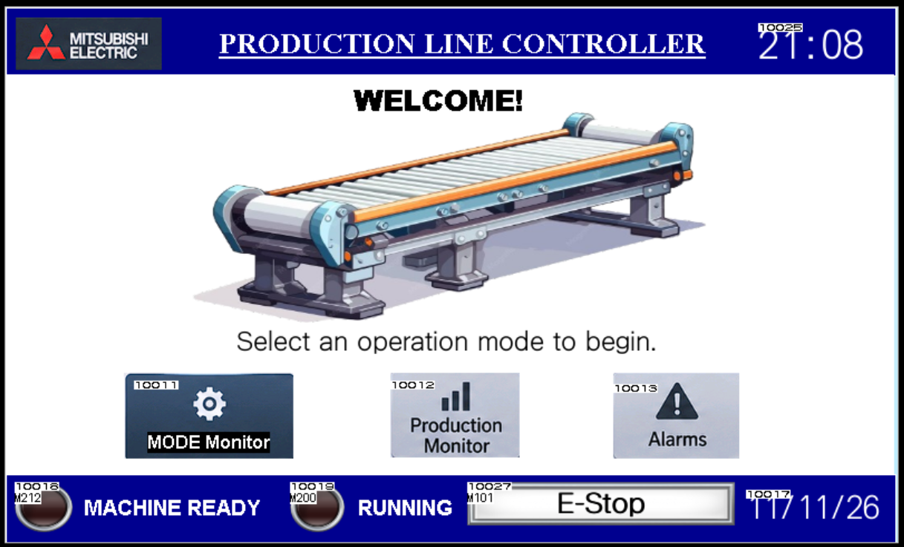
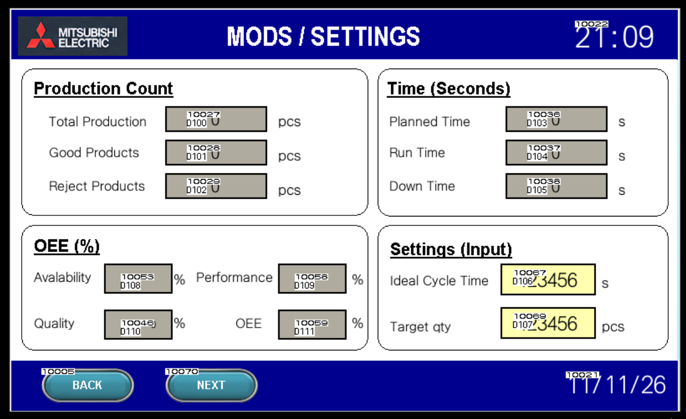
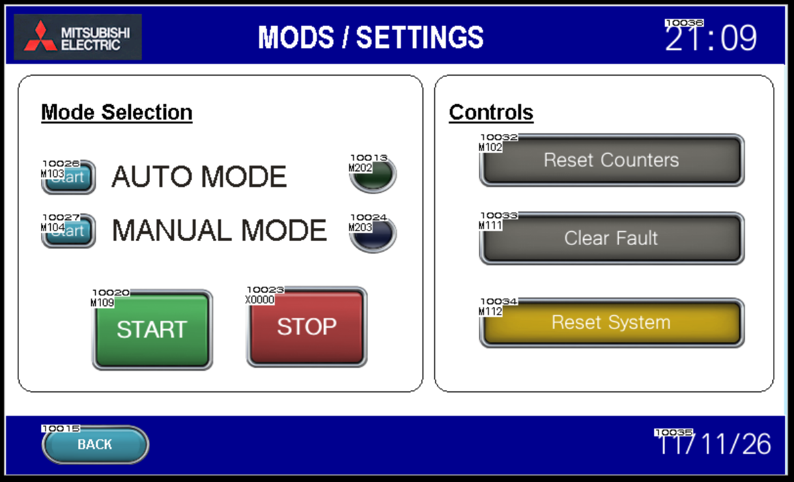
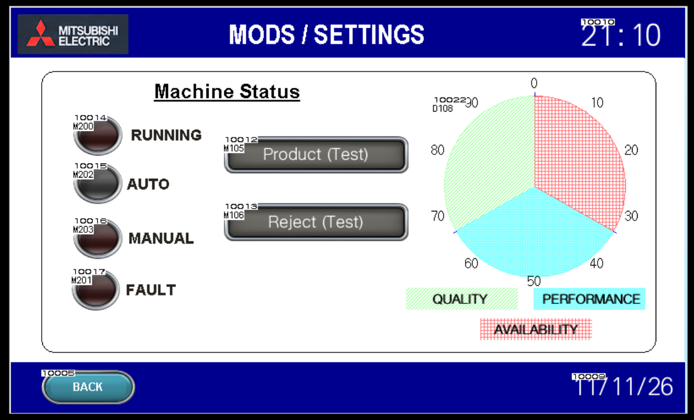
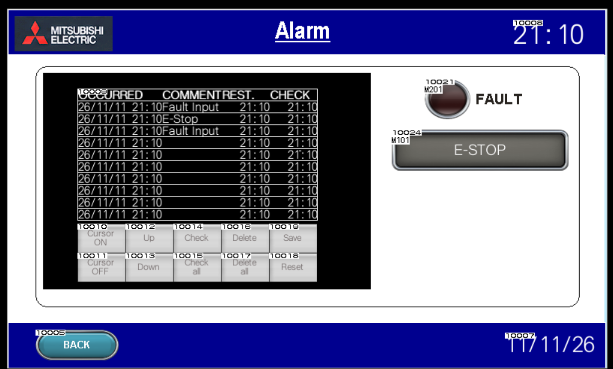

# Industrial OEE Monitoring and Control System

An industrial-style Overall Equipment Effectiveness (OEE) Monitoring and Control System developed using Mitsubishi FX5U PLC and GOT HMI.

The project demonstrates PLC ladder programming, HMI development, production monitoring, machine status tracking, fault handling, and automated OEE calculations.

## Project Overview

The system simulates a conveyor-based production line. The PLC monitors production activity, tracks operating and downtime, counts total and rejected products, detects fault conditions, and calculates OEE.

An HMI provides an operator interface to control the machine and monitor production performance.

## Technology Stack

| Component       | Technology           |
| --------------- | -------------------- |
| PLC             | Mitsubishi FX5U      |
| PLC Programming | GX Works3            |
| PLC Simulation  | GX Simulator3        |
| HMI             | Mitsubishi GOT       |
| HMI Development | GT Designer3         |
| HMI Simulation  | GT Simulator3        |
| Documentation   | Microsoft Excel, PDF |

## System Features

- Automatic and Manual operating modes
- Machine Start and Stop control
- Production counting
- Good and rejected product tracking
- Planned production time monitoring
- Runtime and downtime tracking
- Fault detection and fault reset
- Motor and status indicator control
- Alarm indication and buzzer output
- Automatic OEE calculation
- HMI-based production monitoring

## OEE Calculation

The system calculates four performance values:

**1. Availability**

Runtime / Planned Production Time × 100

**2. Performance**

(Ideal Cycle Time × Total Production) / Runtime × 100

**3. Quality**

Good Products / Total Production × 100

**4. Overall Equipment Effectiveness**

Availability × Performance × Quality

The PLC stores OEE values using a scale factor of 10. For example, 855 represents 85.5%.

## HMI Screens

The project includes four main operator screens:

1. Home – Machine status and operating mode selection.
2. Production Monitor – Production counts, timing information and OEE values.
3. Settings / Modes – Start, Stop, configuration and reset controls.
4. Alarm / Fault – Fault monitoring and alarm management.

## PLC Device Allocation

| Device | Function           |
| ------ | ------------------ |
| Y0     | Motor              |
| Y1     | Green Running Lamp |
| Y2     | Red Fault Lamp     |
| Y3     | Buzzer             |
| D100   | Total Production   |
| D101   | Good Products      |
| D102   | Rejected Products  |
| D103   | Planned Time       |
| D104   | Run Time           |
| D105   | Down Time          |
| D108   | Availability       |
| D109   | Performance        |
| D110   | Quality            |
| D111   | OEE                |

Refer to the Excel device allocation sheet for the complete PLC–HMI mapping.

## Project Files

- `PLC/` – GX Works3 ladder logic project.
- `HMI/` – GT Designer3 HMI project.
- `Documentation/` – Project report and PLC–HMI device allocation.

## Simulation and Testing

The current implementation is a software simulation using GX Works3 and GT Simulator3.

The product and reject sensors are represented by HMI test buttons. Physical sensors, motors and actuators are not connected in the current implementation.

Physical input devices X0–X4 are reserved for future hardware integration.

## Future Scope

- Integrate physical sensors and actuators.
- Connect the system to an actual conveyor production line.
- Introduce industrial data logging.
- Develop real-time production dashboards.
- Implement remote monitoring and analytics.

## Applications

- Industrial automation
- Manufacturing production monitoring
- Machine performance analysis
- PLC and HMI-based control systems
- Industrial OEE analysis

---

**Project Category:** Industrial Automation | PLC | HMI | OEE Monitoring

## HMI Screenshots

The project includes five HMI views developed using Mitsubishi GT Designer3.

### 1. Home Screen


### 2. Production Monitor


### 3. Settings and Modes


### 4. Machine Status


### 5. Alarm and Fault Monitoring


---

## Repository Structure

```text
Industrial-OEE-Monitoring-System/
│
├── PLC/
│   ├── OEE_Ladder_Program.gx3
│   └── README.md
│
├── HMI/
│   ├── OEE_HMI_Design.gtx
│   └── README.md
│
├── Documentation/
│   ├── Final_Report_OEE.pdf
│   ├── PLC_HMI_Device_Allocation.xlsx
│   └── README.md
│
├── Screenshots/
│   ├── 01_Home_Screen.png
│   ├── 02_Production_Monitor.png
│   ├── 03_Settings_Modes.png
│   ├── 04_Machine_Status.png
│   ├── 05_Alarm_Fault.png
│   └── README.md
│
└── README.md
```

## How to Run

1. Open the PLC project using Mitsubishi GX Works3.
2. Open the HMI project using Mitsubishi GT Designer3.
3. Use GX Simulator3 to simulate the PLC program.
4. Use GT Simulator3 to test the HMI screens and PLC interaction.

Refer to the Documentation folder for the detailed project report and device allocation.

**Note:** This project currently uses software simulation. Physical hardware integration is part of future scope.

## License

No license has been assigned to this repository.
